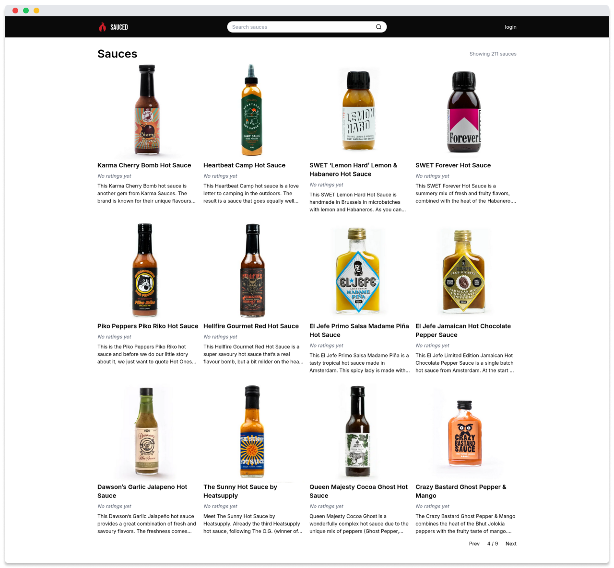

<p align="center">
  
</p>

<h1 align="center"><b>Sauced</b></h1>
<p align="center">A hot sauce rating app.</p>

<p align="center">
  
</p>

## Getting Started

Requires Node 26+ and pnpm (the version is pinned in `package.json`).

Install dependencies:

```bash
pnpm i
```

Copy each `.env.example` to `.env` and set the environment variables:

```bash
cp apps/site/.env.example apps/site/.env
cp packages/db/.env.example packages/db/.env
cp packages/scraper/.env.example packages/scraper/.env
```

The site needs at least `DATABASE_URL` and `BETTER_AUTH_SECRET` (generate one with
`openssl rand -base64 32`). Environment variables are declared in
[`apps/site/src/env.ts`](./apps/site/src/env.ts); add new ones there or they won't be
available to the app.

## Development

Start the databases using [Docker](https://www.docker.com/) with the following command.
This starts the dev database on port 5433, the test database on port 5434, and a
stand-in for Workers AI on port 8788 that review moderation talks to (`docker/ai`; it
flags a few test words instead of running the model):

```bash
pnpm docker:up
```

Apply the database migrations:

```bash
pnpm db migrate
```

See the [db README](./packages/db/README.md) for details on generating new migrations after schema changes.

Seed the database by running a scraper with the following command.
More information about scrapers can be found in the [scrapers README](./packages/scraper/README.md).

```bash
pnpm scrapers scrape <scraper-name>
```

Start the site with the following command:

```bash
pnpm site dev
```

## Testing

Unit tests use [Vitest](https://vitest.dev/):

```bash
pnpm site test:unit
pnpm scrapers test
```

The search tests need real Postgres and get it in memory from PGlite (`@app/db/testing`),
migrated with the same files as production, so they need no database running.

End-to-end tests use [Playwright](https://playwright.dev/) against the test database. They
read `apps/site/.env.test`, which is committed and already points at it. The command
starts the test database, applies the migrations and seeds a test user and sauce:

```bash
pnpm --filter @app/site exec playwright install chromium # first run only
pnpm site test:integration
```

Playwright builds the site and serves it with `wrangler dev`, on workerd like production.
While writing tests, start
`pnpm --filter @app/site exec vite dev --mode test --port 4173` yourself and Playwright
reuses it instead of rebuilding.

CI (`.github/workflows/ci.yml`) runs all of the above on pull requests and on pushes to
`main` and `dev`.

Type-check, lint and format:

```bash
pnpm site check
pnpm lint
pnpm format
```

## Deploying the site

The site runs on Cloudflare Workers, configured in
[`apps/site/wrangler.jsonc`](./apps/site/wrangler.jsonc): `sauced-dev` for `dev`,
`sauced` for `main`. `.github/workflows/deploy-site.yml` builds and deploys on every push
to either. Each Worker reaches Neon through its Hyperdrive config and moderates reviews
through the Workers AI binding; both are defined in [`infra/`](./infra/README.md).
Locally neither is bound: the site uses `DATABASE_URL` and the Workers AI stand-in.

Each GitHub environment (Development, Production) needs:

- secret `CLOUDFLARE_API_TOKEN`: an account token with Workers Scripts Edit
- variable `CLOUDFLARE_ACCOUNT_ID`
- variable `PUBLIC_BASE_URL`: the address the site is served on

The runtime secrets live on the Workers themselves, not in GitHub. Set them once per
Worker; the site refuses to start while one is missing:

```bash
cd apps/site
pnpm wrangler secret put BETTER_AUTH_SECRET --env dev   # and --env production
pnpm wrangler secret put GOOGLE_CLIENT_ID --env dev
pnpm wrangler secret put GOOGLE_CLIENT_SECRET --env dev
pnpm wrangler secret put RESEND_API_KEY --env dev
```

After changing `wrangler.jsonc`, `pnpm site types` regenerates the binding types
(`pnpm site check` does it too).
